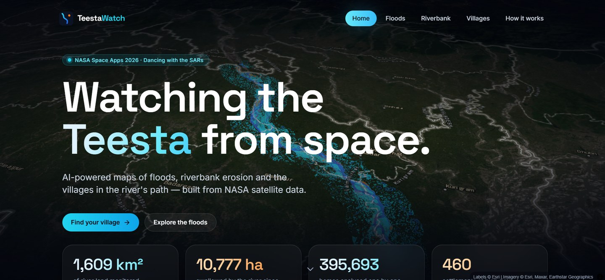
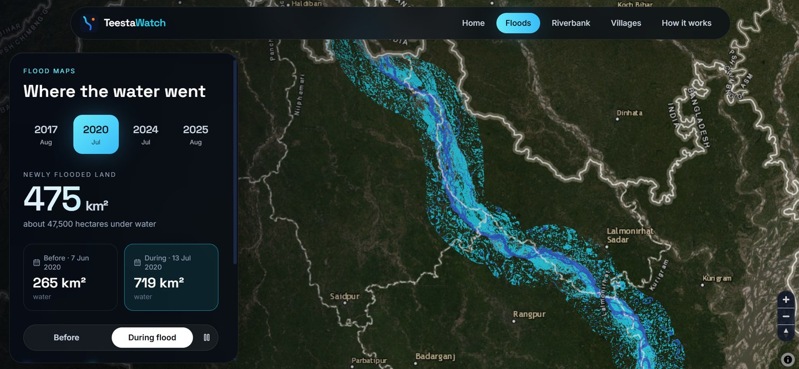
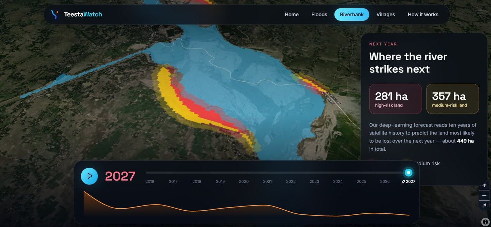
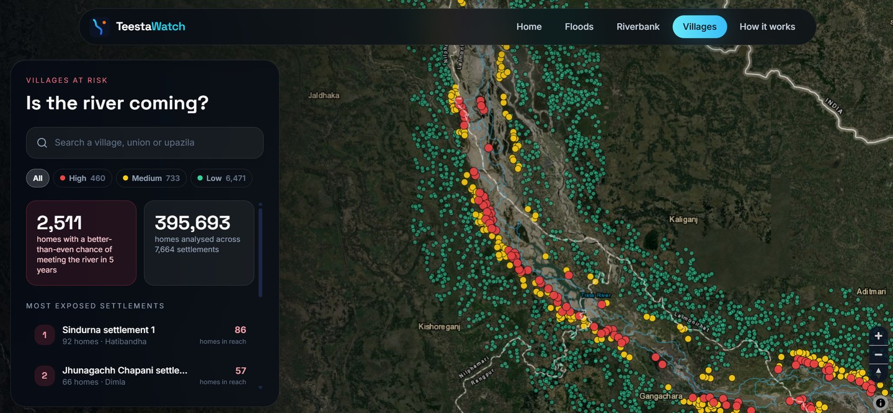

# TeestaWatch Website

**An interactive map website that shows where the Teesta River has flooded, which land it will take next, and which villages are in its path.**

**Live demo: https://aayathossain.github.io/teestawatch-web/**

This is the front end of [TeestaWatch](https://github.com/AayatHossain/teestawatch). The AI models and the satellite data pipeline that produce every map and number live in that repository.

## Screenshots

<div align="center">
  &nbsp;
  <br>
  &nbsp;
</div>

## What the website shows

| Page | What you see | What you can do |
|---|---|---|
| **Home** | A 3D satellite view of the Teesta and the key numbers | Jump straight to the village search |
| **Floods** | Flood water mapped from radar for the 2017, 2020, 2024 and 2025 floods | Switch between before and during each flood, and compare all four |
| **Riverbank** | The river's course every year from 2016 to 2026, the land it took, and the 2027 forecast | Play the years as an animation, or pick any year |
| **Villages** | 7,664 settlements coloured by risk: high, medium or low | Search a village, union or upazila, filter by risk, and zoom in to single homes |
| **How it works** | How satellite data becomes these maps, and how well each part was tested | Read the four steps |

Every page works with a mouse or a finger. On the maps, scroll to zoom, drag to move, and right-click drag (or two-finger drag) to tilt.

## Built with

| Area | Tools |
|---|---|
| Framework | React 19, TypeScript, Vite |
| Maps | MapLibre GL JS with satellite imagery |
| Styling and animation | Tailwind CSS, Framer Motion, GSAP |
| Charts and search | Recharts, Fuse.js (typo-tolerant village search) |
| Hosting | GitHub Pages, deployed by GitHub Actions on every push |

## Run it on your computer

You need [Node.js](https://nodejs.org) 18 or newer.

```bash
git clone https://github.com/AayatHossain/teestawatch-web.git
cd teestawatch-web
npm install
npm run dev        # open the link it prints, e.g. http://localhost:5173
```

To build the finished site:

```bash
npm run build      # creates dist/
npm run preview    # checks the built site locally
```

`dist/` is a plain static site with relative paths, so it runs from any web address with no server set-up.

## Deployment

Every push to `main` rebuilds the site and publishes it to GitHub Pages through [.github/workflows/deploy.yml](.github/workflows/deploy.yml). The new version is live within about two minutes.

## Repository layout

```
src/
  pages/              Home, Floods, River (riverbank), Villages, How
  components/         map view, navigation bar, footer, animated cards and counters
  lib/                data loading and map helpers
public/data/          every map layer and number the site shows (~8 MB)
  stats.json          headline numbers, flood areas, land lost per year, forecast, test scores
  flood/*.png         flood water, before and during each flood
  river/*.png         the river channel each year, and the 2027 forecast
  villages.geojson    7,664 settlements with their risk level and chances
  houses.geojson      homes with at least a 5% chance of meeting the river within 5 years
  river_line.geojson  the 2026 riverbank
```

The files in `public/data/` come from `pipeline/s23_web_export.py` in the [TeestaWatch](https://github.com/AayatHossain/teestawatch) repository. To update the site, run that step and copy its output here.

## Data sources

| Data | Source |
|---|---|
| Sentinel-1 radar | ESA Copernicus, processed by ASF HyP3 |
| Optical images | NASA Harmonized Landsat Sentinel-2 (HLS) |
| Surface water reference | NASA JPL OPERA DSWx |
| Elevation | NASADEM |
| Buildings | Google Open Buildings |
| Administrative boundaries | geoBoundaries |
| Place names | © OpenStreetMap contributors |
| Basemap imagery and labels | © Esri, Maxar, Earthstar Geographics |

## License

Code is released under the [MIT License](LICENSE). Data keeps the licences of its sources above.
